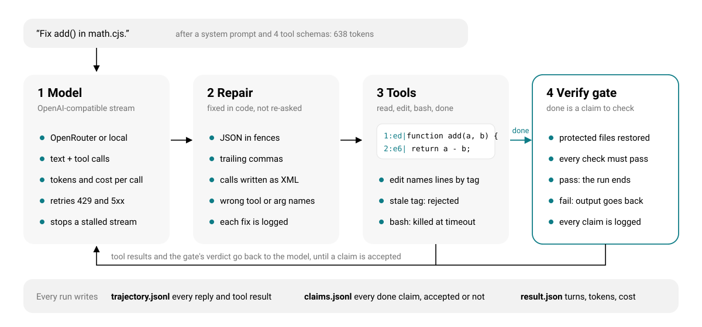

<h1 align="center">Tern</h1>

<p align="center">
  <strong>A terminal coding agent built for small open models.</strong><br>
  Four tools, 638 tokens before the task, and a gate that checks every "done".
</p>

<p align="center">
  <a href="#run-it">Run it</a> ·
  <a href="#how-it-works">How it works</a> ·
  <a href="#results">Results</a> ·
  <a href="docs/BASELINES.md">Baselines</a>
</p>

<p align="center">
  <a href="https://github.com/SanyamWadhwa07/tern/actions/workflows/test.yml"></a>
  <a href="LICENSE"></a>
  
  
</p>

Coding agents are built and tuned for frontier models. Open-weight models of 35B or smaller lose
points to the harness itself: long system prompts, tool calls in a format the model fumbles, edits
that need old text retyped exactly, and "done" taken on the model's word.

Tern's goal is to beat the best published Terminal-Bench 2.0 score for that size class, **24.6%**
(little-coder with Qwen3.6-35B-A3B, [confirmed here](docs/BASELINES.md)), and to report two numbers
no leaderboard shows: **cost per solved task** and **false-done rate**, the share of runs where the
agent says it finished but the hidden tests fail.

**Status:** milestone 1. The harness core runs end to end offline, against a scripted model, in
`npm test`. No benchmark has been run yet.

## Run it

Needs Node.js 22.16 or newer. There is no build step and no runtime dependency.

```bash
npm install
npm test                 # 58 tests, scripted model, no keys, no network
```

Against a real model, any OpenAI-compatible endpoint works. OpenRouter is the default; a paid
endpoint costs money per call.

```bash
export OPENROUTER_API_KEY=...
npm run tern -- --model <openrouter-model-slug> \
  --check "npm test" --protect test/ \
  "Fix the failing date parser in src/dates.ts"
```

For a local server, pass `--base-url http://localhost:8080/v1` and no key.

Each run writes its log to `~/.tern/runs/<time>` (or `--log-dir`) in a training-ready format:
every reply with the model's raw output next to the repaired calls, every tool result, every
"done" claim with its checks, and the conversation in OpenAI chat format. The final grade is added
afterwards with `npm run label -- <log-dir> --passed|--failed`. Details:
[docs/TRAJECTORIES.md](docs/TRAJECTORIES.md).

## How it works



- **A small prompt.** The system prompt is 292 tokens and the four tool schemas 346, so 638 before
  the task (counted with `o200k_base` in a test; Qwen's own tokenizer is not measured yet).
- **Calls are repaired in code.** JSON in markdown fences, trailing commas, calls written into the
  text as Qwen3-Coder `<function=...>` XML, `<invoke>` XML or `<tool_call>` JSON, and wrong tool
  or argument names (`cmd` for `command`, `read_file` for `read`) are fixed without asking the
  model again. Each fix is named in the log, so a run can count them. The history keeps the
  repaired form, so the model sees well-formed calls.
- **Edits name lines, not text.** `read` shows each line as `12:a3|text`, a line number and a
  2-character hash. `edit` replaces or inserts by those tags, so the model never retypes old code,
  and an edit against a stale view is rejected with the current lines. Whether this format alone
  adds points on Terminal-Bench is [not confirmed](docs/BASELINES.md#edit-formats-the-harness-problem-post);
  Tern will measure it against `str_replace`.
- **"Done" is a claim, checked.** A `done` call runs the task's checks. If one fails, the model
  gets the output and keeps working. Every claim is logged with its checks, accepted or not.
- **Tests are read-only.** Protected paths are snapshotted at the start. `edit` refuses them, and
  any `bash` command that changes them is undone right after it runs, with a note to the model.
- **A budget the model can see.** With `--time-limit` or `--token-limit`, the model gets a note at
  75% and at 90% of the limit (attached to the last tool result), and the run stops at 100% with
  its logs written. The same call giving the same result 3 times gets a "try something else" note;
  6 times stops the run as a loop. The same command with a new result counts as progress.

## Results

Terminal-Bench 2.0, 89 tasks × 5 trials, same model for every harness. Plan and adapter:
[`bench/`](bench/README.md).

| Harness | Resolution rate | Cost per solved task | False-done rate |
|---|---|---|---|
| Tern | not measured yet | not measured yet | not measured yet |
| Terminus 2 | not measured yet | not measured yet | not measured yet |
| OpenCode | not measured yet | not measured yet | not measured yet |
| little-coder | 24.6% ± 3.2 on its own local run ([source](docs/BASELINES.md)) | not reported | not reported |

## What is tested

`npm test` runs on Linux, macOS and Windows in CI, with no keys and no network:

- the whole loop on a toy bug fix: a premature "done" is rejected with the failing check's output,
  an edit to the test is refused, a shell command that empties the test is undone, the fix arrives
  as Qwen3-Coder XML and is repaired, and the second claim is accepted
- 15 repair-layer cases: fences, trailing commas, XML and JSON calls in the text, wrong names and types
- anchored reads and edits, stale anchors, Windows line endings
- the streaming client: fragmented tool calls, usage and cost, retries on 429 and 5xx, a stalled
  stream, an error inside the stream
- the run log on disk: the real CLI against a scripted model over local HTTP, then a final label
  that marks the run false-done
- the budget guard: notes at 75% and 90% of a time or token limit, the stop at 100%, and a loop
  stopped at its 6th repeat, both alone and inside the full loop
- the prompt budget, and the CLI's refusal to start without a task, a model or a key

## Next

1. A scratchpad file the agent keeps, instead of lossy history compaction.
2. Pilot runs on 2 or 3 Terminal-Bench tasks to measure tokens per trial and estimate the full cost.
3. Full runs against Terminus 2, little-coder and OpenCode on the same model, with ablations for
   each part (repair layer, anchored edits, verify gate, budget guard).

## Name

The npm name `tern` belongs to the [Tern JavaScript analyzer](https://www.npmjs.com/package/tern),
so this package is `tern-agent`.

## License

[MIT](LICENSE)
